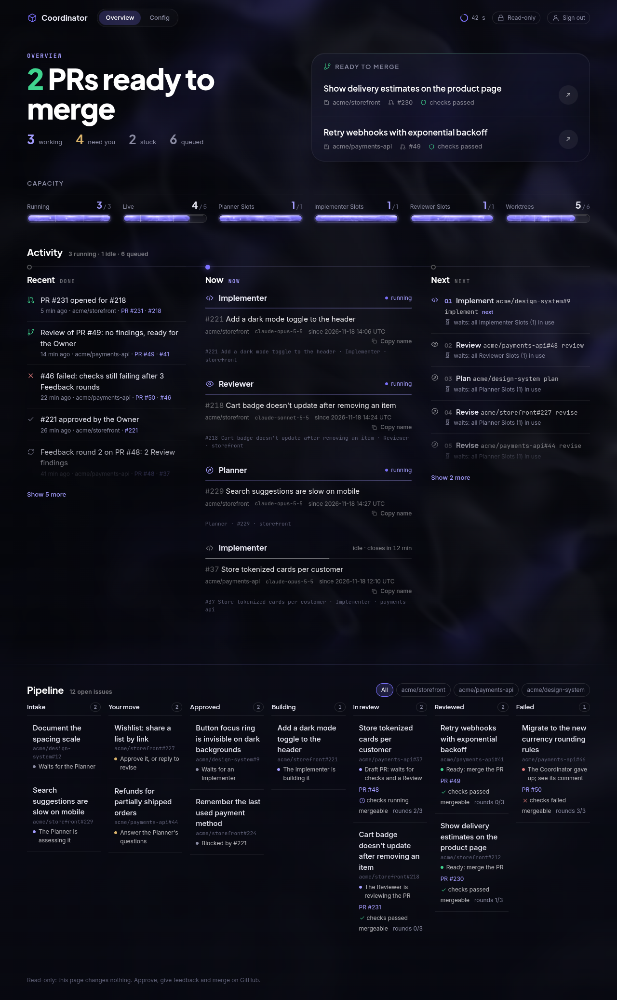
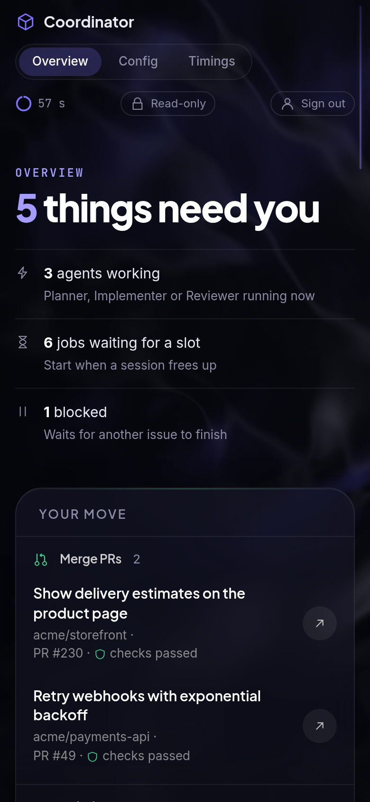
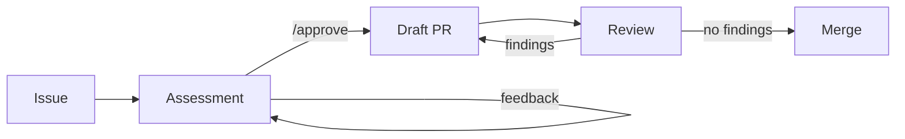
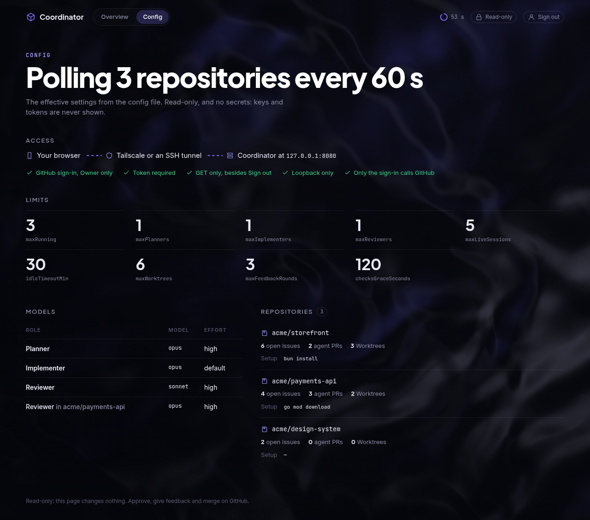
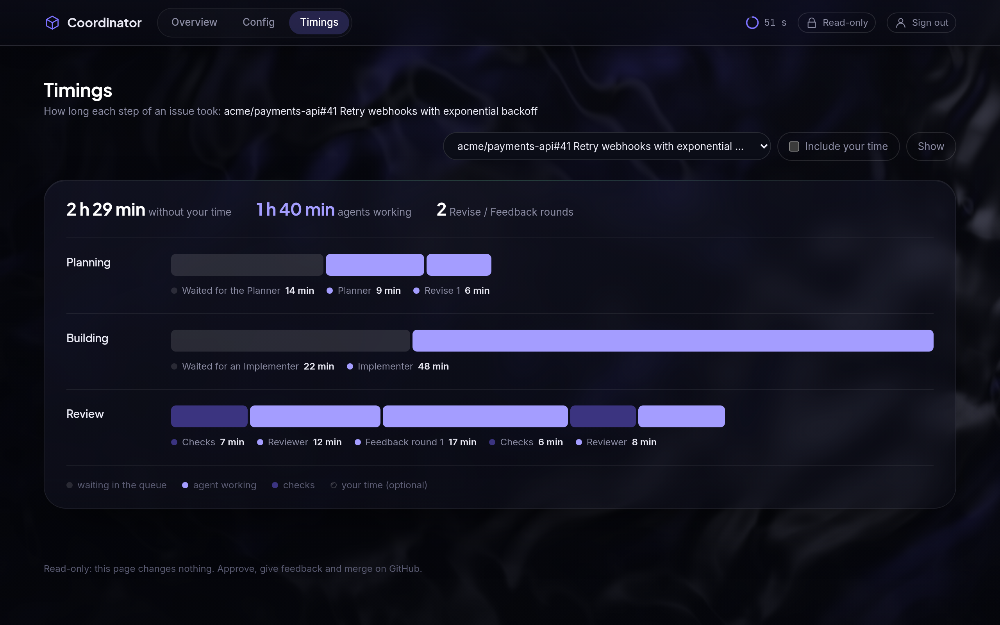
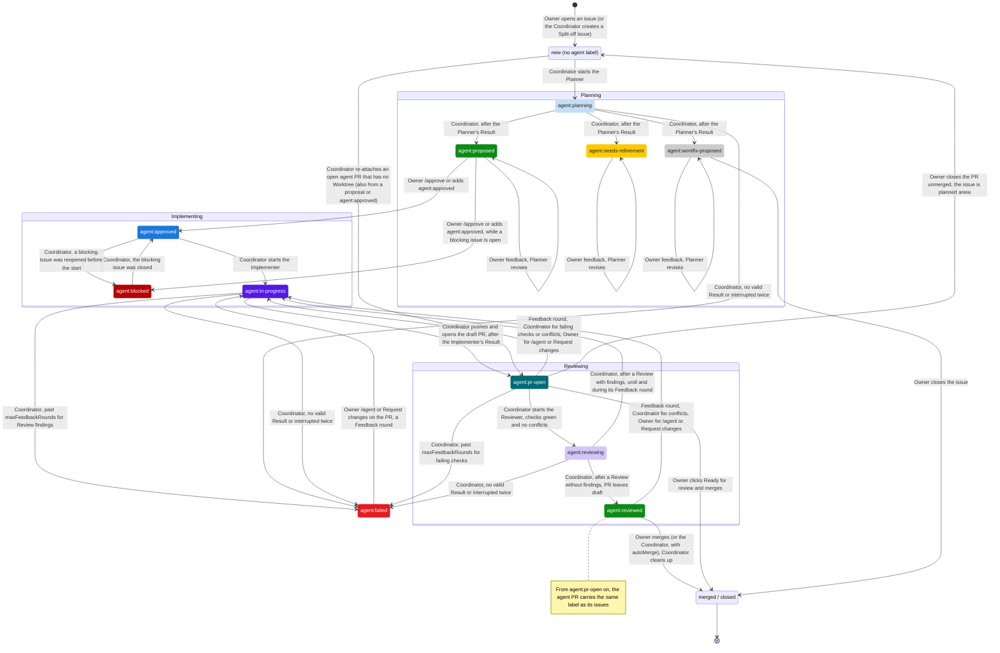

# github-issue-coordinator

[](https://github.com/Flayms/Github-Issue-Coordinator/actions/workflows/ci.yml)

A self-hosted Bun daemon that turns your GitHub issues into reviewed pull requests: Claude Code, Codex CLI or Antigravity CLI agents triage, plan, implement and review them, and nothing is built or merged without your approval.

<p>
  
  
</p>

## Features

- **Approval gates:** a Planner proposes, you `/approve`; only your issues and comments count.
- **One Worktree per issue:** each issue (or Bundle) gets its own branch, checkout and draft PR.
- **Review and Feedback rounds:** a Reviewer with a fresh context reviews every PR; findings, failing checks and conflicts go back to the Implementer.
- **Optional auto-merge:** the Coordinator merges reviewed PRs the Reviewer rated low risk, or none, or all.
- **Several Accounts:** when one subscription hits its usage limit, work goes on with the next.
- **Claude Code, Codex CLI or Antigravity CLI:** each Role runs on the Harness of its model, so a Reviewer on GPT or Gemini can check an Implementer on Opus ([Harnesses](docs/harnesses.md)).
- **Live sessions:** every Claude Code session shows up in the Claude app, where you can follow it and chat with it.
- **Dashboard:** what needs you, what runs and why the rest waits, on your phone too.

## Quick start

You need a Linux VM dedicated to the Coordinator with tmux, git, `gh`, [Bun](https://bun.sh) and [Claude Code](https://code.claude.com) logged in ([prerequisites](docs/setup.md#prerequisites)).

```sh
git clone https://github.com/Flayms/Github-Issue-Coordinator.git ~/github-issue-coordinator
cd ~/github-issue-coordinator && bun install
gh auth login                    # with a fine-grained PAT
cp config.example.ts config.ts   # fill in the Owner, Roles and repositories
bun run doctor                   # checks the setup
bun start                        # or run it as the systemd service
```

The [setup guide](docs/setup.md) walks through each step: the PAT, the ruleset, the config, the dashboard and the service.

## How it works



1. **You open an issue.** Comments, labels and reviews by anyone else are ignored.
2. **The Planner assesses it** in an Assessment comment. Comment to revise it; it answers with a Reply.
3. **You approve** with `/approve [notes]` or the `agent:approved` label.
4. **The Implementer works on it** in its own Worktree; the Coordinator opens a draft PR.
5. **The Reviewer reviews the PR.** Findings and failing checks start a Feedback round, up to `maxFeedbackRounds`.
6. **You merge** once the PR leaves draft, and the Worktree is cleaned up.

The details, from Split-off issues to merge conflicts, are in [docs/how-it-works.md](docs/how-it-works.md).

## Dashboard

- **Overview:** what needs you, Capacity and the Usage quota, Activity (Recent, Now with what each agent is doing and a link to its chat, Next) and the Pipeline.
- **Config:** the settings without secrets; once signed in, change limits, auto-merge and models without a restart.
- **Timings:** how long each step of an issue took.
- On by default at `127.0.0.1:8080`, reached over Tailscale or an SSH tunnel, "Sign in with GitHub" for you only. It changes nothing on GitHub.

<table>
  <tr>
    <td width="50%"></td>
    <td width="50%"></td>
  </tr>
  <tr>
    <td align="center">Config</td>
    <td align="center">Timings</td>
  </tr>
</table>

<sub>Made-up data from <code>test/fixtures/dashboard-mock.ts</code>; <code>bun run screenshots</code> renders them again.</sub>

More: [how it works](docs/how-it-works.md#dashboard) · [setup](docs/setup.md#4-dashboard) · [spec 003](docs/specs/003-dashboard/spec.md)

## Commands (comments by you)

| Command            | Where             | Effect                                                                                                                                                 |
| ------------------ | ----------------- | ------------------------------------------------------------------------------------------------------------------------------------------------------ |
| `/approve [notes]` | proposed issue    | Approves the plan; notes go to the Implementer                                                                                                         |
| `/agent <text>`    | agent PR          | A Feedback round with your text (also: "Request changes" reviews); on a conflicting PR it also merges the default branch, and it clears `agent:failed` |
| `/wake`            | agent issue or PR | Resumes its closed session so you can chat in the Claude app                                                                                           |
| any other comment  | proposed issue    | Revises the plan and gets a Reply                                                                                                                      |

## Labels

Each issue's state is an `agent:*` label; once the agent PR is open, the PR carries the same label as its issues: `agent:pr-open`, `agent:reviewing`, `agent:reviewed`, `agent:in-progress` or `agent:failed`.

You steer with comments, the `agent:approved` label, reviews and merging; the Coordinator applies every other label.

<details>
<summary>The lifecycle as a diagram</summary>



</details>

<details>
<summary>What each label means and what you can do</summary>

| Label                    | Means                                                                                                                                                  | Set by                                                                                                           | What you can do now                                                                                                                                                                               |
| ------------------------ | ------------------------------------------------------------------------------------------------------------------------------------------------------ | ---------------------------------------------------------------------------------------------------------------- | ------------------------------------------------------------------------------------------------------------------------------------------------------------------------------------------------- |
| _(none)_                 | New issue, not planned yet                                                                                                                             | —                                                                                                                | Wait for the next poll                                                                                                                                                                            |
| `agent:planning`         | The Planner is assessing the issue                                                                                                                     | Coordinator, when it starts the Planner                                                                          | Wait, or follow the session in the Claude app                                                                                                                                                     |
| `agent:proposed`         | The Assessment proposes an approach                                                                                                                    | Coordinator, after the Planner's Result (also after each revision)                                               | Reply to revise, or `/approve [notes]` (or add `agent:approved`)                                                                                                                                  |
| `agent:needs-refinement` | The Assessment asks you for details                                                                                                                    | Coordinator, after the Planner's Result (also after each revision)                                               | Reply with the details (or edit the issue); the Planner revises                                                                                                                                   |
| `agent:wontfix-proposed` | The Assessment proposes not to do this                                                                                                                 | Coordinator, after the Planner's Result (also after each revision)                                               | Close the issue, or reply to argue for it                                                                                                                                                         |
| `agent:approved`         | Approved; queued for the Implementer                                                                                                                   | Coordinator on `/approve`, or you (anyone else's is removed); a still blocked issue gets `agent:blocked` instead | Wait                                                                                                                                                                                              |
| `agent:blocked`          | Approved, but an issue it is blocked by is still open                                                                                                  | Coordinator, on approval or before the start                                                                     | Close or finish the blocking issue; it moves back to `agent:approved` by itself                                                                                                                   |
| `agent:in-progress`      | The Implementer is working, first run or Feedback round                                                                                                | Coordinator, when it starts or resumes the Implementer, or after a Review with findings                          | Wait, or chat with the session in the Claude app                                                                                                                                                  |
| `agent:pr-open`          | The draft PR is open: waiting for checks and a Review, or, after an automatic round without a new commit, for you (the Coordinator's comment says why) | Coordinator, after the Implementer's Result, or when it re-attaches an orphaned agent PR (REQ-001-43)            | `/agent <text>` or "Request changes" on the PR for a Feedback round, mark it ready yourself, or merge it                                                                                          |
| `agent:reviewing`        | The Reviewer is reviewing the PR                                                                                                                       | Coordinator, when it starts the Reviewer                                                                         | Wait                                                                                                                                                                                              |
| `agent:reviewed`         | The Review found nothing to fix; once its checks pass, the PR leaves draft, assigned to you, or is merged if `autoMerge` allows its Risk tier          | Coordinator, after a Review without findings                                                                     | Merge, or `/agent <text>` / "Request changes" for another round                                                                                                                                   |
| `agent:failed`           | The Coordinator gave up; its comment says why. No automatic rounds run any more                                                                        | Coordinator                                                                                                      | `/agent <text>` or "Request changes" on the PR for a Feedback round, which clears the label; `/wake` to chat with the session; if it failed in planning, remove the label to have it planned anew |

- The labels show in their GitHub colour, grouped by phase. The Coordinator creates them in each repository.
- An agent PR always carries exactly one label, and only for show: the Coordinator decides from the issue's label.
- Agents don't set labels: their prompts leave that to the Coordinator, which applies them after an agent's Result or on its own checks.
- When an issue carries several agent labels, the most advanced one wins (`PRECEDENCE` in [`src/state.ts`](src/state.ts)), with `agent:failed` above all others.
- Merging or closing the PR clears the issue's agent labels; an issue whose PR was closed unmerged is open again without a label and gets a new Assessment.

</details>

## Configuration

Copy [`config.example.ts`](config.example.ts) to `config.ts`; every option is explained there.

- **Owner, Roles, repositories:** your login and id, a model (and effort) per Role, and each managed repository with its `setup` command.
- **Limits:** Slots per Role, live sessions, Worktrees and `maxFeedbackRounds`. Also editable on the dashboard's Config page.
- **Role prompts:** defaults in [`prompts/`](prompts/); add Extra instructions per Role (globally or per repository) on the Config page, or replace a prompt with `.github/coordinator/<role>.md` ([details](docs/how-it-works.md#customising-prompts)).

### Auto-merge

- `autoMerge`: `evaluated` (default: PRs the Reviewer rated `low` risk), `off` (you merge every PR) or `all`; globally or per repository.
- No gate is skipped: PRs with findings, failing checks or conflicts are never merged, and a PR that changes `.github/workflows/` is always rated `high`.
- More in [docs/how-it-works.md](docs/how-it-works.md#auto-merge).

### Accounts

- List several subscriptions as `accounts`; sessions run on the first one of their Harness that isn't paused by a usage limit.
- A Codex CLI login is an Account with `harness: "codex"`, an Antigravity CLI login (one, a free Google login works) one with `harness: "antigravity"`; what each supports and lacks is in the [feature matrix](docs/harnesses.md#feature-matrix).
- How to log in to each: [setup step 3](docs/setup.md#3-configure), [spec 004](docs/specs/004-accounts/spec.md).

### Security model

- Run it on a VM of its own: agents run with permission prompts skipped and no sandbox.
- The only boundary is GitHub: one fine-grained PAT, limited to the repositories you choose ([spec 005](docs/specs/005-vm-runtime/spec.md)).

## Development

| Command                       | Does                                                                                                                                                        |
| ----------------------------- | ----------------------------------------------------------------------------------------------------------------------------------------------------------- |
| `bun test`                    | The test suite                                                                                                                                              |
| `bun run lint`                | Biome and `tsc --noEmit` (`bun run lint:fix` autofixes)                                                                                                     |
| `bun scripts/smoke-runner.ts` | Real tmux + claude; needs a subscription, so it doesn't run in CI. `--harness codex\|antigravity --fake-model`: real `codex` or `agy`, fake model, no login |
| `bun run screenshots`         | The dashboard screenshots above; needs Chrome or Chromium. `bun test` fails when they are older than the dashboard                                          |

- CI (`.github/workflows/ci.yml`) runs `bun install --frozen-lockfile`, `bun run lint` and `bun test` on every push to `main` and every PR, drafts included, so agent PRs here are checked before their Review.
- Conventions: [`AGENTS.md`](AGENTS.md). Design: [docs/architecture.md](docs/architecture.md), [glossary](docs/glossary.md), [specs](docs/specs/README.md).
