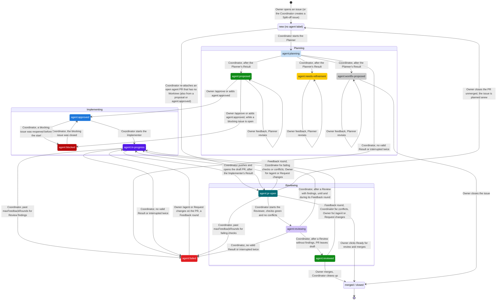

# github-issue-coordinator

A self-hosted Bun daemon that polls GitHub and runs Claude Code agents. They triage, plan, implement and review your issues (one Worktree per issue), with your approval as the gate. Every agent session also shows up in the Claude app, where you can follow it live and chat with it.

## How it works

1. **You open an issue.** Only issues you authored are considered, plus Split-off issues the Planner proposed (below); comments, labels and reviews by anyone else are ignored.
2. **The Planner assesses it** and posts an Assessment comment: proposed approach, questions, and Coordination notes ("do together with #N", "blocked by #N"). Label: `agent:proposed`, `agent:needs-refinement` or `agent:wontfix-proposed`. Comment with feedback to revise the plan: the Assessment is edited in place, and the Planner answers below your comment with a short Reply saying what changed and why. Editing the issue description instead plans it from scratch, without the old plan. If the issue or your comment links to another issue or PR of the same repository (`#N` or its URL), the Planner also gets its recent history: state, labels, timeline events, Reviews and last comments (up to 5 linked items per issue). If an issue mixes independent changes, or the Planner finds a separate bug, it can split off new issues: the Coordinator creates them (at most 5 per Assessment, never twice), links them back, lists them under Coordination, and plans them like your own issues. They still need your approval.
3. **You approve** with `/approve [notes]` or the `agent:approved` label. Nothing said inside a session counts as approval.
4. **The Implementer works on it** in its own Worktree and branch (`agent/<issue>-<slug>`); bundled issues share one. The Coordinator pushes and opens a **draft** PR that closes the issues, so it can't be merged before its Review.
5. **The Reviewer reviews the PR** once its checks pass and it has no merge conflicts, as one review with inline comments (never an approval). The Reviewer reports only findings worth fixing (no nits or matters of taste), and a Review without findings marks the PR ready for review (`agent:reviewed`) and requests your review, so it shows under your review requests on GitHub. Every finding and failing checks go back to the Implementer, up to `maxFeedbackRounds` times, then the PR is labelled `agent:failed`. Merge conflicts go back too, but don't count toward that limit: the Coordinator fetches the default branch and the Implementer merges it, also after a PR was already reviewed. The Implementer answers each finding on the PR (`fixed` or `declined` with a reason), and the next Review sees those answers. If an automatic round ends without a new commit (findings declined, checks still failing, conflicts still there), the Coordinator says why in a PR comment and the PR waits for you: `/agent <text>` to have it fixed anyway, mark it ready yourself, or merge it yourself. `/agent <text>` on a conflicting PR, also a failed one, fetches the default branch first and asks for the merge. Any new commit pushed after a Review turns the PR back into a draft until that commit is reviewed; a failed PR stays a draft. [Labels](#labels) shows the whole lifecycle.
6. **You merge** once the PR has left draft (or click "Ready for review" yourself to override). The Worktree and sessions are cleaned up.

Agents never get GitHub credentials; the Coordinator does every GitHub write as its own GitHub App.

**Dashboard (optional, read-only).** A mobile-friendly page leads with what is ready to merge and how many issues need you, then shows capacity (running and live sessions, Slots, Worktrees), the running agents (with their model and Remote Control names), what runs next and why each item waits, and a pipeline of every issue's phase and PR (checks, mergeability, Feedback rounds) that says what each one needs, filterable by repository. A Config page shows the settings without secrets. It works without JavaScript and loads nothing from other origins (its fonts are self-hosted). It changes nothing; it is off by default, listens on loopback, and is meant to be reached over Tailscale or an SSH tunnel with a token ([setup](docs/setup.md#6-dashboard-optional), [spec 003](docs/specs/003-dashboard/spec.md)).

## Commands (comments by you)

| Command            | Where             | Effect                                                                                                                                                 |
| ------------------ | ----------------- | ------------------------------------------------------------------------------------------------------------------------------------------------------ |
| `/approve [notes]` | proposed issue    | Approves the plan; notes go to the Implementer                                                                                                         |
| `/agent <text>`    | agent PR          | A Feedback round with your text (also: "Request changes" reviews); on a conflicting PR it also merges the default branch, and it clears `agent:failed` |
| `/wake`            | agent issue or PR | Resumes its closed session so you can chat in the Claude app                                                                                           |
| any other comment  | proposed issue    | Revises the plan and gets a Reply                                                                                                                      |

## Labels

Each issue's state is an `agent:*` label on the issue (shown in its GitHub colour, grouped by phase) (an agent PR gets `agent:reviewed` and `agent:failed` too). You steer with comments, the `agent:approved` label, reviews and merging; the **Coordinator** applies every label, after an agent's Result or on its own checks. Agents never set labels: they have no GitHub access. The Coordinator creates the labels in each repository.



| Label                    | Means                                                                                                                                                  | Set by                                                                                                           | What you can do now                                                                                                                                                                               |
| ------------------------ | ------------------------------------------------------------------------------------------------------------------------------------------------------ | ---------------------------------------------------------------------------------------------------------------- | ------------------------------------------------------------------------------------------------------------------------------------------------------------------------------------------------- |
| _(none)_                 | New issue, not planned yet                                                                                                                             | —                                                                                                                | Wait for the next poll                                                                                                                                                                            |
| `agent:planning`         | The Planner is assessing the issue                                                                                                                     | Coordinator, when it starts the Planner                                                                          | Wait, or follow the session in the Claude app                                                                                                                                                     |
| `agent:proposed`         | The Assessment proposes an approach                                                                                                                    | Coordinator, after the Planner's Result (also after each revision)                                               | Reply to revise, or `/approve [notes]` (or add `agent:approved`)                                                                                                                                  |
| `agent:needs-refinement` | The Assessment asks you for details                                                                                                                    | Coordinator, after the Planner's Result (also after each revision)                                               | Reply with the details (or edit the issue); the Planner revises                                                                                                                                   |
| `agent:wontfix-proposed` | The Assessment proposes not to do this                                                                                                                 | Coordinator, after the Planner's Result (also after each revision)                                               | Close the issue, or reply to argue for it                                                                                                                                                         |
| `agent:approved`         | Approved; queued for the Implementer                                                                                                                   | Coordinator on `/approve`, or you (anyone else's is removed); a still blocked issue gets `agent:blocked` instead | Wait                                                                                                                                                                                              |
| `agent:blocked`          | Approved, but an issue it is blocked by is still open                                                                                                  | Coordinator, on approval or before the start                                                                     | Close or finish the blocking issue; it moves back to `agent:approved` by itself                                                                                                                   |
| `agent:in-progress`      | The Implementer is working, first run or Feedback round                                                                                                | Coordinator, when it starts or resumes the Implementer, or after a Review with findings                          | Wait, or chat with the session in the Claude app                                                                                                                                                  |
| `agent:pr-open`          | The draft PR is open: waiting for checks and a Review, or, after an automatic round without a new commit, for you (the Coordinator's comment says why) | Coordinator, after the Implementer's Result, or when it re-attaches an orphaned agent PR (REQ-001-43)            | `/agent <text>` or "Request changes" on the PR for a Feedback round, mark it ready yourself, or merge it                                                                                          |
| `agent:reviewing`        | The Reviewer is reviewing the PR                                                                                                                       | Coordinator, when it starts the Reviewer                                                                         | Wait                                                                                                                                                                                              |
| `agent:reviewed`         | The Review found nothing to fix; the PR left draft, with you as requested reviewer (on the issue and the PR)                                           | Coordinator, after a Review without findings                                                                     | Merge, or `/agent <text>` / "Request changes" for another round                                                                                                                                   |
| `agent:failed`           | The Coordinator gave up; its comment says why (on the issue, and on the PR if there is one). No automatic rounds run any more                          | Coordinator                                                                                                      | `/agent <text>` or "Request changes" on the PR for a Feedback round, which clears the label; `/wake` to chat with the session; if it failed in planning, remove the label to have it planned anew |

Feedback on a proposal (a comment, which gets a Reply, or an edit to the issue, which is planned from scratch) can be given as often as you like; each revised Assessment can change the verdict to any of the three proposal labels. When an issue carries several agent labels, the most advanced one wins (`PRECEDENCE` in [`src/state.ts`](src/state.ts)), with `agent:failed` above all others. Merging or closing the PR clears the issue's agent labels; an issue whose PR was closed unmerged is open again without a label and gets a new Assessment.

## Role prompts

Each Role's default prompt lives in [`prompts/`](prompts/). The Planner decides _what_ and _why_ (Tier, requirements sketched as Given/When/Then, files, tests, risks, decisions with a recommendation), the Implementer decides _how_ within that scope and stops if it turns out wrong, and the Reviewer checks the PR against the approved Assessment without redesigning it ([spec 002](docs/specs/002-role-prompts/spec.md)). A repository can replace a prompt with its own `.github/coordinator/<role>.md`; such a repository doesn't get updates to the default prompts, so compare it with `prompts/` after upgrading.

## Setup

See [docs/setup.md](docs/setup.md): a Linux user with Claude Code logged in, a GitHub App, a ruleset per repository, `config.ts`, and the systemd service. In short:

```sh
bun install
cp config.example.ts config.ts   # fill in the Owner, GitHub App, Roles and repositories
bun run doctor                   # checks the setup
bun start                        # or run it as the systemd service
```

## Development

`bun test` · `bun run lint` · `bun scripts/smoke-runner.ts` (real tmux + claude). See `AGENTS.md` and `docs/`.
